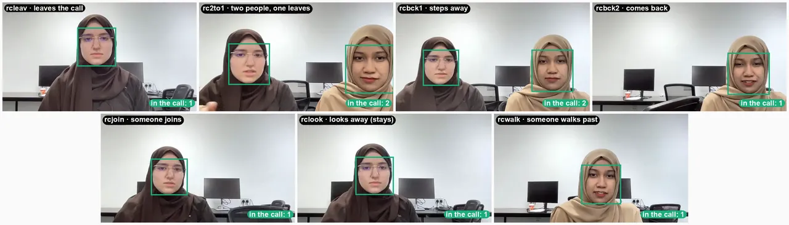

# DuplexNVC

**Full-duplex learned video coding on a laptop chip.**

In a video call, every laptop does two jobs at once: it **encodes** its own camera and **decodes** the video of the other person, and it must finish both within **33.3 ms per frame** at 30 fps. Learned video codecs such as MLVC now run in real time on a laptop's Neural Engine, but every published speed was measured for the encoder *or* the decoder alone, on one processor, and none reports energy. DuplexNVC studies what it costs to run **both directions of a call on one Apple Silicon chip at the same time**, and how to place and schedule them across the **CPU, GPU and Neural Engine (NE)**.

**Team:** Shams Al-Ani, Warda Ul Hasan, Mohammed Alawadhi — American University of Sharjah, COE 694-07 Parallel Computing.

**Reports:** [Literature review](reports/DuplexNVC_Literature_Review.pdf) · [Survey](reports/DuplexNVC_Survey.pdf) · [Phase 2 baseline report](reports/DuplexNVC_Phase2_Baseline_Report.pdf) · [Demo video](demo/) · [How to reproduce](REPRODUCE.md)

---

## What this repository contains

| Folder | Contents |
|---|---|
| [`baseline/`](baseline/) | The Phase 2 **baseline**, in the twelve experiments of our submitted baseline report: smoke tests, Phase 1 check, timing of the core baseline B\*, correctness, quality, energy, processor, model conversion, placement, quality and energy per setting, correctness and drift of every encoder/decoder pair, and contention. Each experiment folder has its scripts, raw data, results and a README with what it shows and what we concluded |
| [`system_measurements/`](system_measurements/) | **Our measurements after the baseline report** (MLVC as released): energy on battery and in Low Power Mode (Step 6), the scene analyzer's cost (Step 7) and the on-device HEVC anchor (Step 9), each with its README |
| [`algorithm_enhancements/`](algorithm_enhancements/) | **Algorithm Enhancements (C5): our changes to how MLVC codes the video**, no retraining, no decoder change: A1 (more bits for key frames, with E4), A2 (drift bounds for a decoder on another processor, the basis of peer-agreed placement), A3 (a forced key frame when people join or leave), and A0 (a check that libmlvc's per-frame controls do what is asked); A4, E3 and E6 next. Each mechanism has its own folder and README |
| [`lab_gpu_runs/`](lab_gpu_runs/) | **Lab GPU Runs: changes to the MLVC network**, fine-tuned on a lab GPU (control, piecewise-linear memory gates B1, B1 + input gate, I-frame dropout B2, a second control for training noise). The whole training pipeline, the input-gate change, complete training logs, the cost of training and the results so far, each folder with its own README |
| [`controller_data/`](controller_data/) | **Step 8: controller data.** 11 stock multi-person clips (HEVC Class E, Pexels) and 6 video-call clips we recorded ourselves (people joining, leaving, stepping away, looking away, someone walking past), face labels and face-size groups, real events annotated manually, and a comparison of Apple Vision's face and body detectors (and their combinations) as scene-change triggers, on stock and call clips separately. Scripts, raw data, results, a video wall of the call clips and a README |
| [`detection_recall/`](detection_recall/) | **Step 7: detection recall.** The smallest face the scene analyzer's face detector (Apple Vision) finds when it runs on the camera frame at the call resolution (360p, 540p, 720p) instead of the full-size original, by face size, on the Step 8 stock clips and our recorded call clips. Scripts, raw data, results, check images and a README |
| [`reports/`](reports/) | Literature review, survey and Phase 2 baseline report (PDF) |
| [`demo/`](demo/) | Demo video: MLVC-S encoding and decoding a talking-head clip, original and decoded side by side |
| [`REPRODUCE.md`](REPRODUCE.md) | How to rerun everything and rebuild every result |

The baseline took about **74 hours** of measurement (≈ 5.3 h for the core baseline B\*, ≈ 24 h for the processor, model conversion and placement experiments, including one run of 21.4 hours, ≈ 10.7 h for quality and energy at every setting and QP, ≈ 33 h for correctness and drift of every encoder/decoder pair together with the A2 drift bounds, and ≈ 1 h for contention), every timed run in the same fixed **quiet mode** (below). The system measurements after it took about 6.6 hours, the other Algorithm Enhancements about 3 hours; runs that were set aside and repeated are described in each experiment's README.

## Key results

### Core baseline B\* (full MLVC, 360p, encoder and decoder on the NE, 30 fps)

| Question | Answer |
|---|---|
| Real time? | **Yes**: 30.01 fps both ways, 0 % late or dropped (5 × 60 s) |
| Margin | Slowest 1 % of frames finish at **29.3 / 28.9 ms** of 33.3 ms |
| Does the NE run both networks in parallel? | **Barely**: sharing is only **1.11×** faster than taking turns (ideal 1.99); each network runs 1.8× slower |
| Energy | **65.3 mJ per frame pair** (≈ 2 W), 97 % on the NE; GPU idle |
| Correctness | No failures; NE decoding is deterministic; GPU/CPU decoding drifts within each I-frame period (worst 38.5 dB) |
| Compression | **−31 %** bits vs Intel hardware HEVC for equal luma PSNR (−41 % YUV) |
| Quality limit | Upscaling 360p to a 1080p screen costs **4–6 dB**, more than the coding itself |

### Placement experiment (7 settings × every encoder/decoder placement)

| Setting | Best placement (encoder–decoder) | Frame rate | p99 (ms) | Energy (mJ / pair) |
|---|---|---|---|---|
| Full MLVC 360p | NE–NE (= B\*) | 30 fps | 29.3 / 28.9 | 65.3 |
| Full MLVC 540p | **GPU–NE** (NE–NE fails: 6 % late) | 30 fps | 31.1 / 25.4 | 635.1 |
| Full MLVC 720p | NE–NE | 15 fps only | — | 404.8 |
| Full MLVC 1080p | none | infeasible | — | — |
| MLVC-S 540p | **NE–NE** (most efficient setting measured) | 30 fps | 26.9 / 26.1 | **45.0** |
| MLVC-S 720p | GPU–NE (NE–NE fails: 3.3 % late) | 30 fps | 25.8 / 24.3 | 333.4 |
| MLVC-S 1080p | NE–NE | 15 fps only | — | 291.6 |

- **23 of 38** combinations meet 30 fps, 9 only 15 fps, 6 neither.
- **No CPU fallback:** every operation of every network runs on the processor it is given.
- **Keep both networks on the NE while they keep up** — it is 3–7× cheaper than any placement using the GPU. When they stop keeping up, move the **encoder** to the GPU and keep the **decoder** on the NE (a decoder off the NE drifts).
- At 30 fps every feasible setting keeps its slowest frames within 24–31 ms: **higher quality is paid for in frame rate, energy or bitrate, not latency.**

### Quality per setting and energy vs quality (7 settings × 5 QPs, 20 evaluation clips)

| Setting | Label | Energy (mJ / pair) | Display PSNR-Y at 287 kbps | Face LPIPS at 287 kbps |
|---|---|---|---|---|
| Full MLVC 360p (B\*) | 30 fps | 63 | 34.25 dB | 0.233 |
| **MLVC-S 540p, NE–NE** | 30 fps | **43** | 35.50 dB | 0.202 |
| MLVC-S 720p, GPU–NE | 30 fps | 339 | 35.98 dB | 0.192 |
| Full MLVC 540p, GPU–NE | 30 fps | 667 | 35.98 dB | 0.190 |
| MLVC-S 1080p, NE–NE | 15 fps only | 291 | 35.76 dB | 0.202 |
| Full MLVC 720p, NE–NE | 15 fps only | 404 | 36.84 dB | 0.179 |
| Full MLVC 1080p, NE–NE | infeasible | 1554 | 36.69 dB | 0.190 |

Energy at 287 kbps from experiment 10 (re-measured at five QPs; B\* 63 mJ, 3 % below the 65.3 mJ of experiment 06).

- **Energy does not depend on the bitrate:** on the NE it changes by 1–2 % from QP 16 to QP 40, so each setting's energy is fixed by its model, size and placement.
- **MLVC-S 540p beats B\*** at screen size at every bitrate where both exist (+0.5 dB at B\*'s 170 kbps, +1.25 dB at 287 kbps; better face LPIPS) **with 32 % less energy**. B\* is dominated.
- **Full MLVC 540p is not worth its energy:** 14–15× MLVC-S 540p for +0.4–0.6 dB; MLVC-S 720p (encoder on the GPU) matches it at half the energy.
- The 30 fps energy–quality front is **MLVC-S 540p (NE–NE)** and **MLVC-S 720p (GPU–NE)**. Moving the encoder to the GPU costs about 4 % in bitrate (encoder–decoder drift).

### Correctness and drift of every encoder → decoder pair (7 settings, 20 clips, 4 QPs; experiment 11)

- **Correct and deterministic everywhere** (19,908 pairs, no failure), **but no two processors decode alike**: drift grows until the next I-frame (worst frames 21–38 dB).
- **H4 fails for every mismatched pair:** +3–7 % bitrate when GPU and NE are mixed, +7–20 % with the CPU; worse at higher resolution and on moving multi-person clips (about twice the cost).

### Contention: memory load against the Neural Engine (B\*, 0–75 % memory load; experiment 12)

- **Memory bandwidth does not limit the NE:** with 217 GB/s of competing traffic the encoder slows by only 4.4 % (the same test on an M1: 18.8 %).
- **A background memory load makes paced calls faster:** 12.6 → 7.4 ms per frame. In the idle gaps of a paced call the chip lowers its clocks; keeping memory busy keeps them up (energy cost not yet measured).

### On-device HEVC anchor (Step 9, [`system_measurements/`](system_measurements/))

- **The Mac's real-time hardware HEVC needs +69 % more bits than B\*** (coded PSNR-Y) and more than twice full MLVC 720p's; only on face LPIPS does it match MLVC-S 720p.
- **But it costs almost nothing to run:** a two-way call on the Mac's video blocks takes 1.6 mJ per frame pair at 360p and 2.6 mJ at 720p (50–80 mW), against 76.7 mJ for B\* (48×), 52.5 mJ for MLVC-S 540p (33×) and 739 mJ for MLVC-S 720p with its GPU encoder (284×), all measured with the chip's own energy counters.

### Energy on battery and in Low Power Mode, and the scene analyzer's cost (Steps 6 and 7, [`system_measurements/`](system_measurements/))

- **On battery the chip spends the same energy as on AC,** at high and low charge (B\* 76.8 mJ per frame pair). **Low Power Mode** saves 6.6 % for B\* with no late frames, but makes 18–20 % of a GPU encoder's frames late (MLVC-S 720p).
- **A B\* call lasts about 10 hours on battery** (the whole laptop draws 7.8 W at maximum brightness, 1.5× the chip's share); MLVC-S 720p with its GPU encoder about 1.7 hours. No thermal drift in a 60-minute call.
- **The scene analyzer fits inside the call:** Vision face and body detection every 15 frames costs 0.63 ms and +0.75 mJ (+1 %) per frame pair, with no late frames; pinning it to the CPU is slower and dearer.

### Algorithm Enhancements (C5, [`algorithm_enhancements/`](algorithm_enhancements/))

- **A2, drift bounds:** LTR recovery bounds drift as well as an I-frame for far fewer bits: every 32 frames, MLVC-S pays +9.6 % (an I-frame every 32: +39–44 %) and the worst frame rises from 21 to 37–38 dB. This is the bound a sender uses when the other laptop decodes on a different processor (peer agreement).
- **A1, key-frame bits:** **−8 on the I-frame is the best offset**: −1.2 % (B\*) and −2.6 % (MLVC-S 540p) on coded PSNR, about −6 % on face LPIPS. A lower QP on LTR frames never helps. **E4:** inside A2's bound the I-frame offset wins back about a fifth of the bound's cost (+9.7 % → +7.7 %).
- **A3, forced key frames:** a key frame forced when people join or leave **does not pay** in MLVC: it costs 11–15 P-frames' worth of bits and the picture after the event is no better (+1.6 % with a perfect trigger, +29 % with a frame-difference trigger). Scene events should change the setting, not force key frames.
- **A0, libmlvc check:** forced key frames, external LTR marking and recovery, and a different QP on every frame **do exactly what is asked on every frame**, and the decoder sees the same structure on the NE and the GPU. One rule to design around: recovering from an older LTR invalidates every newer one.

### Lab GPU Runs: changes to the MLVC network (in progress)

| Question | Answer so far |
|---|---|
| What does a fine-tune of MLVC cost? | **0.23 s per step; ≈ 13 h for 200 epochs (200,000 steps)** on one RTX 3060 Ti (8 GB) |
| What does B1 (hard_tanh / hard_sigmoid gates) cost in quality? | **−0.06 dB PSNR at +0.23 % bitrate** on training clips after 200 epochs, against a control trained on the same samples; it starts 3.4 dB worse and recovers almost all of it ([`lab_gpu_runs/`](lab_gpu_runs/)) |
| Does B1 reduce drift on the GPU/CPU? | To be measured on the Mac with the trained models |

### Step 8: controller data (multi-person clips and our own call clips)



| Question | Answer |
|---|---|
| Data | **11 stock clips**: 3 HEVC Class E (seated, controls) and 8 Pexels (people entering, walking away, groups of 5 and 7, a crowd). **6 call clips we recorded** (MacBook camera at call distance; 7 windows of 10 s): someone leaves, one of two leaves, steps away and comes back, someone joins, looks away (stays), someone walks past behind. 885 faces labelled with Apple Vision on every 10th frame |
| Face sizes | Every group is covered: the stock clips give the **small faces** (248 under 32 px, 238 at 32–63 px at 360p), our call clips the **large ones** (129 at ≥ 128 px, none in the stock clips) |
| Faces as a people count | On the stock clips face detection measures **visible faces, not people present**: about half the people in group scenes, plus faces printed on a poster (68, excluded) |
| Detectors on the stock clips | Faces 3 of 10 real events caught (8 not real), bodies 4 of 10 (9), **max of the two 4 of 10 (7)** |
| **Detectors on our call clips** | **Faces 5 of 5 caught, 0.2–1.8 s after the event starts, 2 not real**; bodies 4 of 5 (9 not real: bodies of people close to the camera are cut off by the frame and flicker). Looking away causes no false event (the face is still found in profile); on the stock clips head turns caused 5 of the 7 false face events |
| Someone walking past (rare in calls) | The only false face events in calls. A **participant rule** (a face counts if it is at least 30 % of the largest face, or has stayed in view for 2 s) removes both and changes nothing else; to be confirmed on new recordings |
| What it means for the controller | In a call: count people with faces plus the participant rule, a change must last 1 s; faces also give face size (the resolution rule). Bodies and a frame-difference trigger only as backup for film-like scenes (faces turned away, crowds) |

Details: [`controller_data/`](controller_data/).

### Step 7: detection recall (smallest face the scene analyzer detects)

| Question | Answer |
|---|---|
| Method | The Step 8 frames scaled down with Lanczos to 360p, 540p and 720p (as the encoder input is made), Apple Vision face detection on each, compared with the same detector on the full-size originals: 560 faces in the 11 stock clips and 257 in our 7 call-clip windows, poster faces left out, match at IoU ≥ 0.5 |
| **On our call clips** | **Every face is found at 360p (257 of 257)**, including faces in profile (looking away) and the person walking past; the only miss in 771 tests is that passer-by's 28 px face once at 720p. The large faces of a call (≥ 128 px at 360p, none in the stock clips) are all found |
| Does detecting at the call resolution lose faces? | **No.** On the stock clips, at 360p the detector finds **98.4 %** of the faces it finds at full size (98.0 % at 540p, 97.7 % at 720p). Re-running at the original's own size finds 96.9 %, so the few misses are small, hard faces near the detector's limit, not a loss from scaling down |
| Smallest face | **Every face of 32 px or more at 360p is found** (96 px at 1080p; one 37 px face missed at 720p). Below 32 px about 1 in 20 is missed. The smallest face in the clips, 14 px at 360p, is still found, so the limit lies below that |
| Hard cases | A crowd (small faces in profile, masked or blurred): 74–85 %. Poster faces are found at every resolution, so a call needs Step 8's size rule or the body detector to ignore them |
| What it means for the controller | The scene analyzer can run on the frame the encoder already has, with no full-size copy. Face-size decisions are reliable from 32 px at 360p, and Step 8's 1 s persistence rule absorbs the occasional missed small face |

Details: [`detection_recall/`](detection_recall/).

## Platform

| | |
|---|---|
| Device | MacBook Pro 14-inch, Apple M4 Pro, 24 GB unified memory |
| OS | macOS 26.6 (build 25G83) |
| Codec | `libmlvc` 0.1.0, commit `eb5d60a`, Core ML back end |
| Models | Full MLVC `dmc61sbr_reglu` and MLVC-S `dmc61sbr_mini_reglu`, public PSNR weights, converted to Core ML fp16 with `mlvc-tools` |
| Measurement program | `duplex_bench`, C++17 on `libmlvc` (alone, turns and duplex modes; unpaced or paced; per-frame timestamps) |
| Power | `powermetrics` (`cpu_power`, `gpu_power`; NE included), idle subtracted |
| Analysis | Python 3 (NumPy, OpenCV, `lpips`), Swift (Core ML `MLComputePlan`, Vision) |
| Steps 7 and 8 (face and body detection) | MacBook Pro 13-inch, Apple M1, macOS 15.5 (face and body detection do not depend on the chip; every label and every Step 7 detection from the same Mac) |
| Data | VCD video-conferencing dataset, scenario `s1`; Step 8: HEVC Class E (Xiph, public domain) and Pexels multi-person clips, and 6 video-call clips we recorded with a MacBook camera (everyone in them agreed) |

## Quiet mode

Every timed and energy run used the same state:

- AC power connected, Low Power Mode off;
- Wi-Fi and Bluetooth off (on only between experiments to copy data);
- screen brightness fixed at maximum, automatic brightness and True Tone off;
- `caffeinate -dims` on, no other apps open;
- 60 s rest after every 60 s run; modes interleaved in rounds;
- first 64 frames of each direction discarded as warm-up; medians over repeated runs;
- placement experiment: thermal state and Low Power Mode logged once per second.

## Repository layout

```
DuplexNVC/
├── README.md                          this file
├── REPRODUCE.md                       how to rerun everything and rebuild every result
├── baseline/
│   ├── README.md                      overview of the twelve experiments of the baseline report and headline results
│   ├── REPRODUCE.md                   setup, run order, conditions, expected values
│   ├── common/                        measurement program, analysis tools, shared scripts, rebuild scripts
│   ├── 01_smoke_test_experiment/      S1, S2: does the pipeline work?
│   ├── 02_phase1_check_experiment/    E3a: does the new program reproduce Phase 1?
│   ├── 03_timing_experiment/          E1–E4, B*: speed, sharing the NE, real time at 30 fps
│   ├── 04_correctness_experiment/     E5: decoding correctness and drift across processors
│   ├── 05_quality_experiment/         E6: BD-rate, rate–distortion, display and face quality
│   ├── 06_energy_experiment/          E7: energy of B* per frame pair
│   ├── 07_processor_experiment/       X1: placement trace; each network alone on NE, GPU, CPU
│   ├── 08_model_conversion_experiment/ X2: full MLVC and MLVC-S at 540p/720p/1080p
│   ├── 09_placement_experiment/       X3: every setting × placement, table of feasible settings
│   ├── 10_quality_per_setting_experiment/ quality of all 7 settings, energy at every QP, energy–quality Pareto
│   ├── 11_correctness_drift_experiment/ Step 5: all 9 encoder→decoder pairs, drift, multi-person
│   └── 12_contention_experiment/       memory load vs the NE: is bandwidth the limit? why are paced calls slow?
├── system_measurements/               our measurements after the baseline report (MLVC as released)
│   ├── README.md                      overview, headline results, how to run, problems met
│   ├── step6_battery_lowpower/        Step 6: battery, Low Power Mode, 30- and 60-min calls
│   ├── step7_scene_analyzer_cost/     Step 7: cost of face and body detection inside the call
│   └── step9_hevc_anchor/             Step 9: the Mac's real-time hardware HEVC at MLVC's bitrates
├── algorithm_enhancements/                  Algorithm Enhancements (C5): how MLVC codes the video, A1–A4
│   ├── README.md                      what C5 is, every enhancement, status and answers so far, how to run
│   ├── A0_libmlvc_check/              A0: do forced key frames, external LTRs and per-frame QP do what is asked?
│   ├── A1_keyframe_qp/                A1: more bits for key frames; E4: A1 inside A2's bound, on MLVC-S
│   ├── A2_drift_bounds/               A2: I-frame period vs LTR recovery as drift bounds (ran in baseline 11)
│   └── A3_forced_keyframe/            A3: a forced key frame when people join or leave
├── lab_gpu_runs/                      changes to the MLVC network, trained on a lab GPU
│   ├── README.md                      why, the runs, setup, settings, problems met, results so far
│   ├── REPRODUCE.md                   how to rerun the training and rebuild the results
│   ├── scripts/                       lab.ps1 (pipeline), patch_input_gate.py, analyze_training.py (+ README)
│   ├── raw_data/logs/                 pipeline, data and complete training logs (+ READMEs)
│   └── results/                       tables, figures and analysis (+ README)
├── controller_data/                   Step 8: multi-person clips, face and body labels, events, detector comparison
│   ├── README.md                      stock clips and our call clips: method, results, participant rule, conclusion
│   ├── scripts/                       s8_setup, s8_prep.py, s8_table.py, bodybox.swift, s8_bodies.py, s8_fusion.py,
│   │                                  rc_sheets.py, s8_rc_add, s8_calls.py, s8_wall.py
│   ├── raw_data/                      clip list, face boxes, real events, poster rule
│   ├── results/                       dataset table, face-size groups, events, faces vs bodies, fusion, calls vs stock, participant rule
│   └── showcase/                      video wall of our call clips (animated WebP)
├── detection_recall/                  Step 7: smallest face the scene analyzer detects, by face size and call resolution
│   ├── README.md                      method, results, conclusion
│   ├── scripts/                       s7_recall.py, s7_run
│   ├── raw_data/                      face boxes at 360p/540p/720p/1080p, machine
│   └── results/                       recall by size, recall curve, smallest face, per clip, extra boxes, check images
├── reports/                           literature review, survey and Phase 2 baseline report (PDF)
└── demo/                              demo video: MLVC-S encoding and decoding on the M4 Pro
```

Each experiment folder holds `scripts/`, `raw_data/`, `results/` and a README. The scripts have descriptive names (for example `quiet_mode_on.sh`, `placement_runs.sh`); during the runs they had short names (`p`, `all`), which the console logs in `raw_data/` still carry. Every folder's README has its old → new table, and the full list is in [`baseline/common/scripts/README.md`](baseline/common/scripts/README.md#old-and-new-script-names).

## Reproducing

Full guide: [`baseline/REPRODUCE.md`](baseline/REPRODUCE.md) (summary in [`REPRODUCE.md`](REPRODUCE.md)). Setup takes a few hours of downloads and builds; the twelve baseline experiments take about 74 hours, the longest being the resumable 21.4-hour placement experiment. Without a Mac, every table and figure can be rebuilt from the raw data with the three scripts in [`baseline/common/analysis/`](baseline/common/analysis/). Lab GPU Runs (Windows PC with an NVIDIA GPU) and their analysis: [`lab_gpu_runs/REPRODUCE.md`](lab_gpu_runs/REPRODUCE.md).

## Next steps

The baseline is complete (twelve experiments). After it, energy on battery and in Low Power Mode (Step 6), the scene analyzer's cost (Step 7) and the HEVC anchor's quality and energy (Step 9) are measured ([`system_measurements/`](system_measurements/)), and of our Algorithm Enhancements, A0 (libmlvc's per-frame controls checked), A1 with E4, A2 (for the 30 fps settings) and A3 ([`algorithm_enhancements/`](algorithm_enhancements/)). Still to be measured: A4, E1–E3 and E6, and the Lab GPU models on the Mac. Multi-person data is done (Step 8, [`controller_data/`](controller_data/)), including six video-call clips we recorded (faces catch every join and leave in them; a participant rule handles someone walking past), and so is the detector's recall at the call resolution (Step 7, [`detection_recall/`](detection_recall/): every face from 32 px at 360p is found). DuplexNVC itself — a controller that chooses placement, schedule, resolution and model from the content and the energy state — will then be measured against B\* with exactly this protocol.
