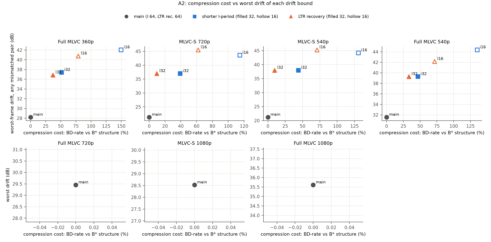

# A2 — Bounding drift when the encoder and the decoder run on different processors

**Question.** When the decoder runs on a different processor than the encoder (or on another laptop), its picture drifts away from the encoder's reconstruction, and the drift grows until the next I-frame ([`baseline/11`](../../baseline/11_correctness_drift_experiment/): worst frames 21–38 dB, +3–20 % in bitrate). Two ways to stop it sooner: (a) a shorter I-frame period (32 or 16 instead of 64), or (b) libmlvc's *LTR proactive recovery*, which predicts a frame from an older long-term reference (LTR) every 32 or 16 frames instead of from the previous frame. **Which bound limits the worst drift for the fewest bits, for each setting?** The answer is the per-placement drift bound of DuplexNVC's central contribution (drift-aware, peer-agreed placement): each sender uses the bound for the decoder it is talking to.

## What was run

A2 ran inside baseline experiment 11 ([`baseline/11_correctness_drift_experiment`](../../baseline/11_correctness_drift_experiment/)), because it needs exactly the same 9 encoder → decoder pairs, on a MacBook Pro 14-inch M4 Pro, macOS 26.6.2, libmlvc `eb5d60a`, normal use (quality only):

- **In total 2,240 jobs and 58.5 h of runs**, in two parts (every job = one clip at one QP, decoded on all 9 pairs):
  - full MLVC 360p (B\*) and 540p, MLVC-S 540p and 720p: 20 Nov 2026, 12:31 am – 11:00 pm and 21 Nov, 10:40 pm – 22 Nov, 8:01 am (+04); 1,280 jobs, 15.2 h (the `l16` failure on MLVC-S and its fix are described in experiment 11);
  - full MLVC 720p and 1080p, MLVC-S 1080p: 23 Nov, 4:17 pm – 26 Nov, 8:15 pm, as the Mac's overnight filler, paused three times for other measurements and resumed where it stopped (nothing repeated); 960 jobs, 43.3 h. These jobs are slower (about 4.3 minutes each at full MLVC 1080p against about half a minute at 360p). Every job decoded on all 9 pairs without a failure.

- **Bounds** (`mlvc encode` options): I-frame every 32 (`i32`: `--iframe-period 32`) and every 16 (`i16`); LTR recovery every 32 (`l32`: `--ltr-period 16 --ltr-recovery-period 2`) and every 16 (`l16`: `--ltr-period 8 --ltr-recovery-period 2 --ltr-start-idx 0`); against the default structure (an I-frame every 64 frames).
- **Settings:** all seven: full MLVC 360p (B\*), MLVC-S 540p and MLVC-S 720p (the two 30 fps settings on the energy–quality front), full MLVC 540p, and full MLVC 720p, MLVC-S 1080p and full MLVC 1080p (which reach only 15 fps or none, measured for completeness).
- **Content and metrics:** the 20 evaluation clips at QP 16/24/32/40; every bitstream encoded on the NE, GPU and CPU and decoded on all three. **Cost** = BD-rate (coded PSNR-Y) of NE → NE with the bound against NE → NE with the default structure; **drift** = the worst frame over the 6 mismatched pairs (PSNR-Y of the decode against the decode on the encoder's processor).
- **Scripts and raw data:** experiment 11's `scripts/` (`drift_runner.py`, `drift_tables.py`, `PHASE=a2`). The per-run rows of the first four settings are in experiment 11's `raw_data/r.csv` (structure `i32`, `i16`, `l32`, `l16`; the `l16` failure on MLVC-S and its fix are described there); those of the other three are here, in `raw_data/r_a2_720p_1080p.csv`, same columns.

## Results

**Cost and worst frame per bound** (cost = BD-rate of NE → NE against the default structure; worst frame over the 6 mismatched pairs):

| Setting | Default | LTR recovery every 32 | I-frame every 32 | LTR recovery every 16 | I-frame every 16 |
|---|---|---|---|---|---|
| Full MLVC 360p (B\*) | 0 % → 28.2 dB | +36.9 % → 36.9 dB | +51.4 % → 37.4 dB | +78.8 % → 40.8 dB | +149.8 % → 42.0 dB |
| MLVC-S 540p | 0 % → 21.2 dB | **+9.7 % → 38.0 dB** | +44.1 % → 38.0 dB | +70.7 % → 45.3 dB | +130.8 % → 44.2 dB |
| MLVC-S 720p | 0 % → 21.3 dB | **+9.5 % → 37.0 dB** | +39.1 % → 37.0 dB | +62.0 % → 45.5 dB | +114.7 % → 43.6 dB |
| Full MLVC 540p | 0 % → 31.6 dB | +33.3 % → 39.3 dB | +46.8 % → 39.3 dB | +71.6 % → 42.2 dB | +135.0 % → 44.4 dB |
| Full MLVC 720p | 0 % → 29.5 dB | +30.6 % → 38.0 dB | +42.6 % → 38.0 dB | +66.2 % → 44.0 dB | +121.4 % → 45.2 dB |
| MLVC-S 1080p | 0 % → 28.5 dB | **+8.7 % → 36.4 dB** | +31.2 % → 36.4 dB | +47.7 % → 45.7 dB | +89.3 % → 45.9 dB |
| Full MLVC 1080p | 0 % → 35.6 dB | +24.4 % → 41.3 dB | +33.7 % → 41.3 dB | +53.2 % → 44.7 dB | +94.6 % → 46.0 dB |

The worst frame of the default structure, and of most bounds, involves the CPU (as encoder or decoder); `results/a2.csv` gives the worst frame of every pair.

## Conclusion

1. **LTR recovery bounds drift as well as an I-frame does, for far fewer bits, at all seven settings.** At every 32 frames both raise the worst frame to about the same level (36–41 dB); LTR recovery costs about a quarter of the bits on MLVC-S (+8.7–9.7 % against +31–44 %) and about 70 % on full MLVC (+24–37 % against +34–51 %). Every 16 frames, LTR recovery costs about half of an I-frame for a worst frame within 2 dB of it.
2. **On MLVC-S, LTR recovery every 32 frames is the cheapest bound** (+8.7–9.7 % from 540p to 1080p). On full MLVC every bound costs more, and less at higher resolutions (LTR recovery every 32: +36.9 % at 360p, +24.4 % at 1080p). It is the bound the peer agreement uses for a mismatched decoder; when both sides decode on the same processor type (NE ↔ NE, GPU ↔ GPU), no bound is needed.
3. **A1 on top of the bound wins back about a fifth of its cost** (+9.7 % → +7.7 %, E4 in [`A1_keyframe_qp`](../A1_keyframe_qp/)).

## Files

| Path | Contents |
|---|---|
| `results/a2.csv`, `results/multi_person/a2.csv` | Cost and worst frame per setting and bound, and the worst frame of every mismatched pair (VCD clips, all seven settings; multi-person clips where measured) |
| `results/summary_a2.txt` | The A2 table as printed by `drift_tables.py` |
| `raw_data/r_a2_720p_1080p.csv` | Per-run rows (clip × QP × encoder × decoder) of the bounds for full MLVC 720p, MLVC-S 1080p and full MLVC 1080p |
| `raw_data/cfg/` | The encoder settings libmlvc reported for each of those settings and bounds |
| `raw_data/logs/out_all.txt` | Console log of those runs (23–26 Nov), recorded under the script's old name `all` |
| `results/fig_a2.png`, `fig_a2.pdf` | Cost against worst frame |
