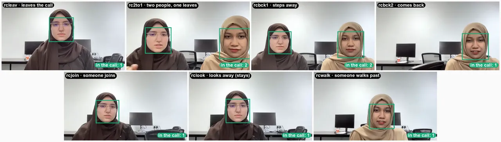

# 08 — Controller data: multi-person clips, face labels and face-size groups (Step 8)



*Our recorded call clips with the face detector working live: green box = a face counted as a participant, "not a participant" = someone walking past behind (`rcwalk`), left out by the participant rule and not counted; white note = the real event. MacBook camera at call distance, 30 fps; faces from Apple Vision every 1/3 s. Lightened slightly for display; the masters and all data are untouched. Full-size MP4: `call_clips_wall.mp4` in the Drive folder [Our recorded call clips](https://drive.google.com/drive/folders/1nSD9B0X19jTrVycgy_M4HNL-9fU2dn3_?usp=drive_link).*

**Owner:** Warda · **Machine:** Warda's M1. Step 8 does not depend on the chip, and all face labels come from this one Mac.

The data has two parts: **11 stock clips** (HEVC Class E and Pexels: groups, crowds, small faces, filmed like films) and **6 call clips we recorded ourselves** (a laptop camera at call distance, people joining, leaving and stepping away as in a real call; 7 windows of 10 s).

**Questions.**
1. Which multi-person clips, with people entering and leaving, will the controller, A3, A4 and E1 be tested on?
2. How many faces fall in each face-size group at 360p, and does every group have enough faces?
3. Where in each clip does the number of people actually change (the scene changes A3 and A4 react to), and does Apple Vision see those changes?

The baseline's 20 evaluation clips are single VCD talking heads: every face is at least 32 px tall at 360p, and only 6 faces fall in 96–191 px at 1080p (experiment 10). Face-size groups and scene changes need new content.

## Stock clips (11, run on 20 Nov 2026)

The set has three roles: **entries with faces toward the camera** (the face trigger should react), **people entering or leaving with their faces away from the camera** (only a frame-difference trigger can react; this happens often in real calls: someone walks off, or enters with their back turned), and **controls** where nobody enters or leaves (no trigger should fire).

| id | Source file | Source size, fps, length | Master | What happens | Role |
|---|---|---|---|---|---|
| `ce4peo` | `FourPeople_1280x720_60.y4m` | 1280×720, 60 fps, 10.0 s | 300 frames | 4 people seated | control |
| `cejohn` | `Johnny_1280x720_60.y4m` | 1280×720, 60 fps, 10.0 s | 300 frames | 1 person, poster behind him | control |
| `cekris` | `KristenAndSara_1280x720_60.y4m` | 1280×720, 60 fps, 10.0 s | 300 frames | 2 people, poster behind them | control |
| `px2ent` | `2_people_entering_room.mp4` | 4096×2160, 25 fps, 29.9 s | 300 frames from 2 s | a man and a boy enter far from the camera; a woman enters close to the camera, back turned | entries (faces away / far) |
| `pxentr` | `people_entering_room.mp4` | 3840×2160, 25 fps, 15.3 s | 300 frames | a family of 3 enters through a door | entry (faces toward) |
| `px4ppl` | `4_people.mp4` | 4096×2160, 25 fps, 30.6 s | 300 frames | 4 people enter an empty meeting room one by one | entries (faces toward) |
| `px5ppl` | `5_people.mp4` | 1920×1080, 25 fps, 33.4 s | 300 frames | 5 people seated in a meeting | control |
| `px7ppl` | `7_people.mp4` | 1920×1080, 25 fps, 20.8 s | 300 frames | 7 people in a meeting | control |
| `pxcrwd` | `people_entering.mp4` | 3840×2160, 30 fps, 8.8 s | 265 frames | a crowd walks out of arrival doors toward the camera | entries (many people) |
| `pxleav` | `people_leaving.mp4` | 3840×2160, 25 fps, 6.0 s | 148 frames | people walk away from the camera into a café | leaving (faces away) |
| `pxdown` | `people_leaving_going_downstairs.mp4` | 3840×2160, 25 fps, 7.3 s | 182 frames | 3 people walk away toward a door and stairs | leaving (faces away) |

- **HEVC Class E** (`ce…`): Xiph derf collection (`https://media.xiph.org/video/derf/y4m/`), public domain, 600 frames.
- **Pexels** (`px…`): Pexels licence, free to use.
- **VCD** is not part of this step: all 160 VCD clips (`th`, `th-ob`, `th-bb`, `th-m`) show one person throughout (VCD README), so VCD contributes to the controller data through the baseline's 20 evaluation clips, which give the large-face groups. VCD's data licence is CDLA-Permissive 2.0.

## What was run

- **Master clip** (`scripts/s8_prep.py`): up to 300 frames (10 s) at 30 fps from `start_s`; the three short sources give masters of their full length (148–265 frames), recorded in `meta.json`. ffmpeg is told the exact number of output frames for every clip.
  - 60 fps sources (Class E) keep every 2nd frame. 25 fps sources keep every frame and are relabelled to 30 fps (`setpts`), as the baseline did, so no frame is duplicated or interpolated.
  - Sources that are not 16:9 (4096×2160) are first cropped in the centre to 16:9, so faces are not squashed (`cropped_to_16x9` in `meta.json`).
  - Sources of 1080p or more are scaled to 1920×1080 with ffmpeg's Lanczos filter. Class E stays 1280×720, so its display-scale reference is 720p and its 720p setting is the original.
  - x264 CRF 10. The master plays the role of VCD's 1080p MP4 in the baseline.
- **Encoder inputs** (360p/540p/720p NV12) are made from the master on the Mac that runs the codec, with the baseline's command (`scale=W:H:flags=lanczos`, NV12).
- **Face labels:** every 10th master frame, Apple Vision `VNDetectFaceRectanglesRequest` with the baseline's `common/code/facebox.swift`. JSON as in the baseline's face cache (`i` = JPG index), plus `frame` = master frame index.
- **Face-size groups:** face height scaled to 360p: <32, 32–63, 64–127, ≥128 px (= <96, 96–191, 192–383, ≥384 px at 1080p, the bins of experiment 10's `facesize.csv`).
- **Poster faces** (`raw_data/exclude.csv`): in `cejohn` and `cekris` a poster with printed faces stands behind the speakers; faces under 45 px at 360p there are not participants (the real faces are 66–115 px, the printed ones 21–32 px). They stay in `faces_step8.csv` with `participant = 0` and are left out of people counts, groups and events.
- **Automatic events** (`scripts/s8_table.py`): a change in the number of participant faces that holds for 3 labelled frames (1 s).
- **Manual annotation:** real events were annotated manually by inspecting every 10th master frame and one frame per second of each full source clip; event times are accurate to ±10 frames (0.33 s). Face boxes were also checked by eye on the first, middle and last labelled frame of each clip.

## How to run

```bash
conda deactivate                                             # if Anaconda is installed
./s8_setup <path-to-repo>                                    # tools, folders, facebox (once)
# put the clips in ~/Downloads/duplexnvc-baseline/phase2/step8/src, list them in clips.csv,
# poster faces in exclude.csv (optional)
~/Downloads/duplexnvc-baseline/.venv/bin/python s8_prep.py   # masters + face labels (resumable)
~/Downloads/duplexnvc-baseline/.venv/bin/python s8_table.py  # tables, groups, events, check images
swiftc -O bodybox.swift -o ~/Downloads/duplexnvc-baseline/tools/bodybox   # body detector (once)
~/Downloads/duplexnvc-baseline/.venv/bin/python s8_bodies.py # faces vs bodies on the same frames
~/Downloads/duplexnvc-baseline/.venv/bin/python s8_fusion.py # five ways to combine faces and bodies
```

Software versions are in `machine.txt` (ffmpeg 9.0.2, Python 3.12.16, NumPy 2.5.5, OpenCV 5.1.0, Swift 6.1.2).

## Files

| Path | Contents |
|---|---|
| `raw_data/clips.csv` | Clip list: id, source, file, start, licence, URL, notes |
| `raw_data/exclude.csv` | Clips with poster faces and the size limit used |
| `raw_data/meta.json` | Per clip: source size, fps, frames kept, crop, master size |
| `raw_data/faces/<id>.json` | Apple Vision face boxes on every 10th master frame |
| `raw_data/events_truth.csv` | Real entries and leaving, annotated manually |
| `raw_data/events_checked.csv` | Each automatic event, confirmed or not, with what actually happens |
| `results/dataset_table.csv` | One row per clip: sizes, length, people (max, median), background faces, events, faces per group, smallest and largest face |
| `results/faces_step8.csv` | One row per labelled face, with its group and `participant` |
| `results/groups.csv` | Participant faces and clips per size group |
| `results/events.csv` | Automatic face events (rewritten by every run of `s8_table.py`) |
| `results/bodies_step8.csv` | One row per body box (Apple Vision body detector), with confidence |
| `results/body_events.csv` | Automatic body events (same 1 s rule as faces) |
| `results/faces_vs_bodies.csv` | One row per real event: caught by faces? by bodies? delay |
| `results/detector_summary.csv` | Per clip: bodies found (max, median), face and body events, events that were not real |
| `results/fusion_summary.csv` | Five ways to combine faces and bodies: real events caught, automatic events, not real, median delay |
| `results/fusion_events.csv` | One row per real event: the frame where each method caught it |
| `results/calls_vs_stock.csv` | Every method (faces, bodies, or, and, max) scored separately on the stock clips and on our call clips |
| `results/participant_rule.csv` | Faces with and without the participant rule, on both sets |
| `results/participant_rule_events.csv` | Every automatic face event with and without the rule: when, from how many faces to how many, real or not |
| `showcase/call_clips_wall.webp` | Our call clips playing at once, with the faces counted as participants (green) and the person walking past labelled "not a participant"; the full-size MP4 is in the Drive folder of our recordings |
| `scripts/rc_sheets.py`, `scripts/s8_rc_add` | One frame every 0.5 s of each recording (to read the event times); add the call clips and rerun everything |
| `scripts/s8_calls.py`, `scripts/s8_wall.py` | Stock vs call clips and the participant rule; the video wall |
| `machine.txt` | Hardware, macOS, ffmpeg and Python of the labelling Mac |

## Recorded call clips (6 recordings, 7 windows, run on 23 Nov 2026)

The stock clips are filmed like films: the camera is across the room and people move about the scene. A video call is one laptop camera about 50–80 cm away, with people facing it. So we recorded the events of a real call ourselves, in that setting, and ran them through exactly the same scripts.

| id | Recording | Window | What happens | Role |
|---|---|---|---|---|
| `rcleav` | `rcleav.mov`, 11.4 s | 0–10 s | one person faces the camera, stands up at 3.0 s and leaves the frame; the empty chairs stay in view | leaving (1 → 0) |
| `rc2to1` | `rc2to1.mov`, 32.0 s | 15–25 s | two people side by side; the one on the right stands up at 20.5 s and leaves; the other keeps talking | leaving (2 → 1) |
| `rcbck1` | `rcback.mov`, 23.8 s | 3–13 s | two people; the one on the left stands up at 7.5 s and leaves | leaving (2 → 1) |
| `rcbck2` | `rcback.mov` | 14–23.8 s | the same person comes back (arm in view at 17.5 s, seated facing the camera at 20.0 s) | joining (1 → 2) |
| `rcjoin` | `rcjoin.mov`, 17.7 s | 3–13 s | one person talking; a second enters from the right at 7.5 s and sits down next to her | joining (1 → 2) |
| `rclook` | `rclook.mov`, 12.4 s | 0–10 s | one person turns her head away at 1.0 s and talks in profile; she does not leave | false-alarm test |
| `rcwalk` | `rcwalk.mov`, 11.0 s | 0–10 s | one person talking; someone walks past behind her from 4.0 to 6.5 s without joining | false-alarm test |

- **How they were recorded:** MacBook camera (1080×720, 30 fps), camera effects off (Center Stage, Portrait, Studio Light, Reactions), the laptop still at call distance (50–80 cm; 80–100 cm for two people; the person walking past 2–3 m behind), a plain background with no posters or photos of faces. Everyone who appears agreed to the clips being stored and used in the report.
- **Windows:** every clip is analysed over 10 s, as the stock clips are. `rcback`'s person is away for about 10 s, so its leaving and its return are two windows (`rcbck1`, `rcbck2`). The recordings are 1080×720 (3:2), so the masters are cropped in the centre to 16:9 and scaled to 1280×720; no face is cut.
- **Real events:** the start of each event (the second someone stands up or first comes into view), read from one frame every 0.5 s of each full recording (`scripts/rc_sheets.py`), in `events_truth.csv`.
- **Added with** `scripts/s8_rc_add` (rows in `clips.csv` and `events_truth.csv`, then `s8_prep.py`, `s8_table.py`, `s8_bodies.py`, `s8_fusion.py` on all 18 windows). `scripts/s8_calls.py` scores every method separately on the stock and the call clips and tests the participant rule; `scripts/s8_wall.py` makes the video wall.

## Where the videos are

The videos are not in git (the repo ignores `.mp4`, `.y4m` and `.nv12`). They are in the team's Google Drive:

| Drive folder | Contents |
|---|---|
| **[Step 8 master videos](https://drive.google.com/drive/folders/1Lve-EM16QhhRZU8_kebwevPCfzI3N87J?usp=drive_link)** | the masters (`<id>_<width>x<height>_30.mp4`) and `meta.json`: 11 stock clips and the 7 call-clip windows |
| [Original source clips](https://drive.google.com/drive/folders/1oWpQzQQ0RcG-FsGjj5eCvFNP4mEe8kJ0) | the 11 original clips the masters were made from (names as in the clip table) |
| [Our recorded call clips](https://drive.google.com/drive/folders/1nSD9B0X19jTrVycgy_M4HNL-9fU2dn3_?usp=drive_link) | the 6 recordings (`rc….mov`) and the video wall at full size (`call_clips_wall.mp4`) |

**Use the masters, not the sources, for every codec run.** All frame numbers in `raw_data/` and `results/` (face boxes, events) refer to the master frames. Download them into `~/Downloads/duplexnvc-baseline/phase2/step8/master/`; the encoder inputs at 360p/540p/720p are made from these files with the baseline's command.

## Results: stock clips

**Faces.** 628 faces in 301 labelled frames: 560 participants and 68 poster faces (53 in `cejohn`, 15 in `cekris`).

| Face height at 360p | Participant faces | Clips | Baseline (20 VCD clips) |
|---|---|---|---|
| < 32 px | 246 | 9 | none |
| 32–63 px | 236 | 7 | 6 faces |
| 64–127 px | 78 | 2 | 400 faces |
| ≥ 128 px | 0 | 0 | 198 faces |

**People per clip** (participant faces, every 10th frame, max / median): `ce4peo` 4 / 4, `cejohn` 1 / 1, `cekris` 2 / 2, `px2ent` 2 / 0, `pxentr` 4 / 2.5, `px4ppl` 4 / 2, `px5ppl` 4 / 3 (5 present), `px7ppl` 4 / 3 (7 present), `pxcrwd` 3 / 1, `pxleav` 1 / 0, `pxdown` 1 / 0.

**Real events** (`events_truth.csv`): 8 entries in 4 clips and 2 leaving clips.

| Clip | Event (master frame) |
|---|---|
| `px4ppl` | one person enters at 20, 70, 80 and 110 |
| `pxentr` | a family of 3 enters at 90 |
| `px2ent` | a man and a boy enter at 20 (far); a woman enters at 250 (close, back turned) |
| `pxcrwd` | a crowd enters from 60 to the end |
| `pxleav`, `pxdown` | people walk away from the camera through the whole clip |

**Automatic events against the real ones** (`events_checked.csv`):

| | Count |
|---|---|
| Automatic events | 11 |
| Real (confirmed) | 4: `px2ent` 250, `pxentr` 190, `px4ppl` 90, `pxcrwd` 220 |
| Not real (heads turning, someone leaning into view, a man turning to the camera) | 7 |
| Delay after the first person enters | `px2ent` (woman) 0, `px4ppl` 70 frames (2.3 s), `pxentr` 100 (3.3 s), `pxcrwd` 160 (5.3 s) |
| Real events with no automatic event | the distant entry in `px2ent` (frame 20); both leaving clips (faces never toward the camera) |

### Faces vs bodies

The same frames (every 10th master frame) were also run through Apple Vision's human body detector (`VNDetectHumanRectanglesRequest`, full body; `scripts/bodybox.swift`, `scripts/s8_bodies.py`). Bodies were turned into events with the same 1 s rule as faces, and both were scored against the real events: a real event counts as caught when an event in the same direction starts between 10 frames before it and 150 frames (5 s) after it.

| | Faces | Bodies |
|---|---|---|
| Real events caught within 5 s (of 10) | 3 (the crowd's face event is real but 5.3 s late) | 4 |
| Automatic events / not real | 11 / 8 | 13 / 9 |
| `pxentr` family entry | 3.3 s late | on time |
| `px2ent` distant entry (frame 20) | missed | 1.0 s late |
| `px2ent` close entry, back turned (frame 250) | on time | missed |
| `px4ppl` four entries | 1 caught (2.3 s) | 2 caught (2.0 s, 2.7 s) |
| `pxcrwd` crowd, `pxleav`, `pxdown` | missed | missed |

| People per clip (median per labelled frame) | Present | Faces | Bodies |
|---|---|---|---|
| `px7ppl` | 7 | 3 | 5 |
| `px5ppl` | 5 | 3 | 2 |
| `pxcrwd` | crowd | 1 | 7 |
| `pxleav`, `pxdown` (seen from behind) | several / 3 | 0 / 0 | 3 / 3 |
| `cejohn` (poster behind) | 1 | 1 (after removing 53 poster faces) | 1 (no poster bodies) |

Body detection took a median of 7.4 ms per full-size frame on the M1 (the cost on a call-time thumbnail is measured in Step 7).

- **Bodies count people better when faces are away**: people seen from behind (3 vs 0), the crowd (7 vs 1), the meeting of 7 (5 vs 3), and printed people on the poster are not boxed. Seated people hidden behind a table are the exception (`px5ppl`: 2 vs 3).
- **As a trigger, bodies are as noisy as faces**: they catch one more real event and are faster on the family entry, but produce as many false events; in `px2ent` a mirror doubles the people (up to 5 bodies for 2 people).
- **Neither detector marks "walking away"** in `pxleav` and `pxdown`: the people walk away but stay in view, so the number of people never drops. An exit test needs a clip where someone leaves the frame.

### Combining faces and bodies

`scripts/s8_fusion.py` combines the two detectors on the same frames, with the same 1 s rule and the same scoring (no new detection): **or** (an event from either; two in the same direction within 1 s count once), **and** (only when both have one in the same direction within 1 s, at the later of the two), and **max** (per frame, people = the larger of participant faces and bodies, events on that count).

| Method | Real events caught (of 10) | Automatic events | Not real | Median delay |
|---|---|---|---|---|
| Faces | 3 | 11 | 8 | 2.3 s |
| Bodies | 4 | 13 | 9 | 2.0 s |
| Or | 5 | 22 | 17 | 1.0 s |
| And | 1 | 2 | 1 | 2.3 s |
| **Max** | **4** | **11** | **7** | **2.0 s** |

- **Max is the best single trigger:** as many real events as bodies, with the fewest events that are not real among the methods that still catch events. **Or** catches the most and fastest but more than doubles the false events; **and** almost never fires.
- **No method catches the rest, because of what the clips contain:** in `px4ppl` the third and fourth people enter 1–3 s after the second, while the count is still changing, so the 1 s rule merges them into one change (one switch for a group arriving is the behaviour the controller needs); in `pxcrwd` people keep arriving, so the count never settles; in `pxleav` and `pxdown` people walk away but stay in view.

## Results: our recorded call clips

**Faces.** 257 faces in 210 labelled frames, all participants except the person walking past in `rcwalk`. Call distance gives the large faces the stock clips lack: 124 faces at 64–127 px and **129 at ≥ 128 px at 360p** (stock: 0). With them, the set has every face-size group: < 32 px 248 faces in 10 windows, 32–63 px 238 in 8, 64–127 px 202 in 9, ≥ 128 px 129 in 6.

**Every method on the stock clips and on the call clips** (`results/calls_vs_stock.csv`; same detectors, same 1 s rule, same scoring):

| Method | Stock: real events caught | Stock: not real | **Calls: real events caught** | **Calls: not real** | Calls: median delay |
|---|---|---|---|---|---|
| Faces | 3 of 10 | 8 | **5 of 5** | **2** | 0.7 s |
| Bodies | 4 of 10 | 9 | 4 of 5 | 9 | 1.2 s |
| Or | 5 of 10 | 17 | 5 of 5 | 12 | 0.5 s |
| And | 1 of 10 | 1 | 2 of 5 | 1 | 1.2 s |
| Max | 4 of 10 | 7 | 5 of 5 | 2 | 0.5 s |

The delay is from the start of the real event to the labelled frame where the count changes; the controller acts once the new count has held for 1 s.

**Per clip, faces:** `rcleav` leave caught 0.7 s after she stands up; `rc2to1` 0.8 s; `rcbck1` 0.2 s; `rcbck2` return 1.8 s; `rcjoin` 0.5 s. `rclook`: no event at all. `rcwalk`: 2 events that are not real (the person walking past counted as joining at 4.0 s and leaving at 6.0 s).

**What is not real** (`results/participant_rule_events.csv`, `results/body_events.csv`):
- **Faces (2):** both in `rcwalk`, the person walking past.
- **Bodies (9):** 7 from bodies flickering on people who sit close to the camera and are cut off by the frame edge (`rc2to1` 2, `rcbck2` 4, `rcjoin` 1), 2 from the person walking past. Bodies also miss `rcleav`, where the seated person close to the camera is rarely boxed.

**Turning away does not fool the face detector in a call.** In `rclook` she talks in profile for 9 s and the face is found in all 30 labelled frames (its box shrinks from 126 to about 74 px at 360p), so nothing fires. In the stock clips, heads turning away caused 5 of the 7 false face events (`events_checked.csv`): there the faces are small and far, and a turned head is lost. At call distance it is large enough to be found in profile.

**Someone walking past behind (`rcwalk`) is the one case that fools the face count.** This is rare in a video call, where people usually sit alone or together in front of the laptop, but it happens (a family member, a colleague in an open office) and should not count as a participant joining. The passer-by and the people in the call differ in two ways: the passer-by's face is small (28–37 px at 360p against 116–169 px), and it is in view only briefly (about 2 s). `scripts/s8_calls.py` tests a **participant rule** that uses both: **a face counts as a participant when it is at least 30 % of the size of the largest face in the frame, or when it has stayed in view for 2 s** (so someone who sits down further back still counts once they stay).

| Faces | Stock: caught | Stock: not real | Calls: caught | Calls: not real |
|---|---|---|---|---|
| 1 s rule (as above) | 3 of 10 | 8 | 5 of 5 | 2 |
| **1 s rule + participant rule** | 3 of 10 | 8 | **5 of 5** | **0** |

The rule removes both false events in `rcwalk` and changes nothing else on either set. The 30 % and the 2 s were chosen by looking at these clips, which contain one passer-by, so the rule has to be confirmed on new recordings (for example someone walking past closer to the camera). Size alone already removes the passer-by here; the 2 s condition is what keeps a small participant who stays. (Requiring every join to last 2 s instead also removes the passer-by, but loses real entries in the stock clips: 1 of 10 caught.)

## Conclusion

1. **Every face-size group is covered** by this step and the baseline together: the new clips give the small groups (246 faces under 32 px in 9 clips, 236 in 32–63 px in 7 clips), which the baseline lacks; the baseline's talking heads give the large ones. This supports the controller rule "a face of this size needs at least this resolution".
2. **Faces found are not people present.** In group clips Apple Vision finds about half of the people (median 3 of 7 in `px7ppl`, 3 of 5 in `px5ppl`), because faces turn away, look down or are hidden, and it also finds printed faces on a poster (68 boxes in two clips). The controller has to treat the face count as a lower bound and ignore faces that never move.
3. **A face-count trigger alone is late and blind to faces turned away.** Of 11 automatic events, 4 are real, arriving 0–5.3 s after the first person enters; the distant entry and both leaving clips produce no face event at all. **The body detector does not fix this on its own:** it counts people far better when faces are away, but as a trigger it is as noisy as faces (4 of 10 real events caught, 9 false). Combined, the larger of the face and body counts is the best single trigger (4 of 10 caught, 7 not real, against 8 and 9 for each alone). The controller should use faces for face size (the resolution rule), the combined count for how many people are present and when that changes, and a frame-difference trigger as the backup for scenes whose count never settles (a crowd), with persistence (a change must last 1 s) on all of them.
4. **Clips for the next steps:** `px4ppl`, `pxentr`, `px2ent` and `pxcrwd` for entries; `pxleav` and `pxdown` for leaving; `ce4peo`, `cejohn`, `cekris`, `px5ppl` and `px7ppl` as controls, where nothing should trigger.
5. **In real call scenes the face detector is enough.** On our recorded call clips, faces catch every join and leave (5 of 5), 0.2–1.8 s after it starts, with 2 events that are not real against 8 on the stock clips. A head turned away is still found at call distance (`rclook`: no event). The body detector, which helped on the film-like stock clips, is worse in calls (4 of 5, 9 not real): bodies of people sitting close to the camera are cut off by the frame and flicker. So in call mode the controller should count people with faces and keep bodies only as a backup for scenes where faces are turned away or far.
6. **Someone walking past behind is the remaining weakness, and it is rare in calls.** A participant rule using both face size and time in view (at least 30 % of the largest face, or in view for 2 s) removes both passer-by events and costs nothing on either set; it has to be confirmed on new recordings, since the thresholds were chosen on these clips.
