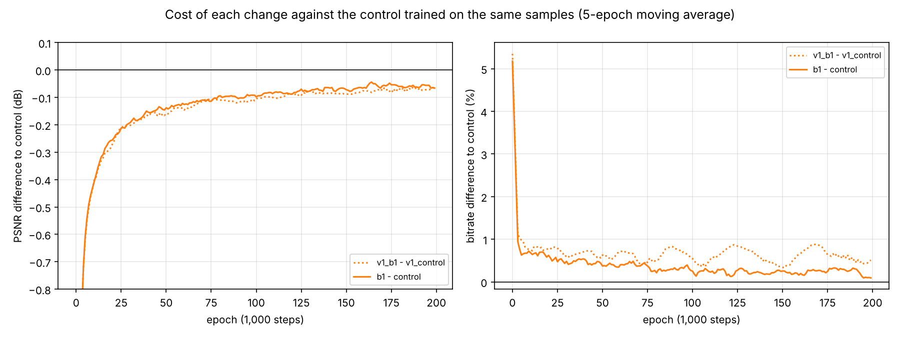

# Results and analysis

Built from the logs in [`../raw_data/logs/`](../raw_data/logs/) by [`../scripts/analyze_training.py`](../scripts/) (`python3 analyze_training.py`). They cover:

| Runs | Trained | Status |
|---|---|---|
| `v1_control`, `v1_b1` (first runs, replayed samples) | 20 Nov 21:21 – 21 Nov 23:40 | Complete, 200 epochs each; kept for reference |
| `control`, `b1` (Queue A, a seed per chunk) | 22 Nov 18:08 – 23 Nov 20:47 | Complete, 200 epochs each |
| `b1gate`, `b2p25`, `b2p75`, `control_s2` (Queue B+C) | From 23 Nov 20:47 | Running; added when complete |
| `b1` continued to 400 epochs (Run 6) | After Queue B+C | Waiting |

**Every number here is a training number:** measured on training samples, not on the VCD test clips, and silent about drift across processors. Those are measured on the Mac with the checkpoints in the release.

## Files

| File | What it holds | Columns |
|---|---|---|
| [`training_cost.csv`](training_cost.csv) | The cost of training on the lab GPU | `quantity`, `value`, `note` |
| [`training_per_epoch.csv`](training_per_epoch.csv) | Every complete epoch of every run | `run`, `epoch` (from 0), `loss`, `bpp` (latent + hyperprior), `psnr_db`, `s_per_100_steps` — each the mean of the epoch's 10 log lines |
| [`training_summary.csv`](training_summary.csv) | Each run against the control trained the same way: at the end of training (`span = end`, last 40 epochs) and over the whole run (`all`) | `run`, `compared_with`, `span`, `epochs`, `n_epochs`, `loss`, `bpp`, `psnr_db`, `loss_minus_control`, `loss_diff_sd` (spread of the per-epoch difference), `psnr_minus_control_db`, `bpp_vs_control_pct` |
| [`training_gap_by_block.csv`](training_gap_by_block.csv) | The same comparison in blocks of 20 epochs: how a change's cost develops during training | `run`, `compared_with`, `epochs`, `control_psnr_db`, `run_psnr_db`, then as above |
| [`training_parity.csv`](training_parity.csv) | Even against odd epochs, per run | `run`, `epochs`, `even_loss`, `odd_loss`, `odd_minus_even_loss`, `even_psnr_db`, `odd_psnr_db` |
| [`training_curves.png`](training_curves.png) | Loss and PSNR per epoch of every run (5-epoch moving average) | — |
| [`training_gap.png`](training_gap.png) | B1 minus control, PSNR and bitrate, per epoch | — |

## Analysis

### 1. What a fine-tune costs

| Quantity | Value |
|---|---|
| Time per training step (2 samples × 4 frames, 256 × 256) | **0.23 s** |
| Time per epoch (1,000 steps), including the restart every 2 epochs | **4.0 min** (the restarts add about 3 %) |
| One 200-epoch run (200,000 steps) | **13.2 h** on one RTX 3060 Ti (8 GB) |
| Rounds measured | 198, none failed (v1 and Queue A) |
| Data preparation, once (download 50 GB, extract 5,411 sequences) | ≈ 8 h |

**Meaning.** Changing MLVC's network costs about **13 GPU-hours per variant** on a consumer GPU, after an 8-hour one-time data preparation; four 200-epoch runs finished in four days on a shared lab PC. A GPU with more memory would allow MLVC's own larger batches and longer sequences, so these numbers are an upper bound on the cost.

### 2. The fix for replayed samples works

| Run | Odd − even epoch loss |
|---|---|
| `v1_control` | **+0.0032** |
| `v1_b1` | +0.0022 |
| `control` | **−0.0004** |
| `b1` | −0.0018 (−0.0005 without the first 20 epochs, while B1 is still adapting) |

The first runs restarted every 2 epochs with the same seed, and MLVC does not save its random state, so every chunk drew the same 2 × 2,000 samples: even and odd epochs were two fixed sample sets, about 0.003 apart in loss for the whole run. With a seed per chunk (Queue A) the gap is gone: every epoch sees new samples.

### 3. The first runs memorised their samples; the new control has converged

| | Epochs 0–9 | Epochs 90–99 | Epochs 190–199 | Change over the run |
|---|---|---|---|---|
| `v1_control` loss / PSNR | 0.1649 / 30.15 dB | 0.1561 / 30.37 dB | **0.1523 / 30.47 dB** | −7.6 % / +0.32 dB |
| `control` loss / PSNR | 0.1654 / 30.20 dB | 0.1631 / 30.33 dB | **0.1628 / 30.26 dB** | −1.6 % / +0.06 dB |

- **v1 kept improving only because it saw the same ≈ 4,000 samples about 100 times.** Its loss fell steadily to the end (−0.0035 per 100 epochs over the second half); the lower final loss is memorisation, not better compression. **The v1 models are not used as results.**
- **The new control is flat after about 20 epochs** (−0.0007 per 100 epochs over the second half, less than its epoch-to-epoch spread of 0.002). With fresh samples, fine-tuning at these settings changes the released model very little. That is what a control should do: it stays close to the released MLVC, so differences against it come from the change being tested, not from fine-tuning itself.

### 4. What B1 costs in quality

B1 replaces the memory's tanh and sigmoid with hard_tanh and hard_sigmoid. Swapping the functions under trained weights first breaks the model; training then adapts the weights to the new functions.

| Epochs | Control PSNR | B1 PSNR | B1 − control: PSNR | Bitrate | Loss |
|---|---|---|---|---|---|
| 0 (first epoch) | 30.27 | 26.87 | **−3.40 dB** | +7.7 % | +0.161 |
| 0–19 | 30.22 | 29.57 | −0.65 dB | +1.10 % | +0.0194 |
| 20–39 | 30.22 | 30.02 | −0.20 dB | +0.50 % | +0.0049 |
| 40–59 | 30.25 | 30.11 | −0.14 dB | +0.40 % | +0.0036 |
| 80–99 | 30.29 | 30.19 | −0.10 dB | +0.31 % | +0.0025 |
| 120–139 | 30.27 | 30.20 | −0.08 dB | +0.22 % | +0.0021 |
| 160–179 | 30.30 | 30.24 | −0.06 dB | +0.25 % | +0.0017 |
| **180–199** | 30.28 | 30.22 | **−0.06 dB** | **+0.23 %** | **+0.0016 (+1.0 %)** |

From [`training_gap_by_block.csv`](training_gap_by_block.csv).

- **B1 recovers almost all of its initial loss.** The first epoch loses 3.4 dB; after 20 epochs the gap is 0.2 dB, after 200 it is **0.06 dB at +0.23 % bitrate** (loss +1.0 %).
- **The cost is consistent.** At the end of training, B1's loss is above the control's in every epoch, with a spread of only 0.0002 around +0.0017: both runs see exactly the same samples, so their difference comes from the change alone.
- **The gap is still closing, slowly.** About 0.03 dB per 100 epochs over the second half (−0.086 dB at epochs 100–119, −0.060 dB at 180–199). Run 6 (B1 to 400 epochs) shows whether it keeps closing.
- **The same in both versions.** The PSNR gap follows the same curve in v1 and Queue A (−0.071 against −0.058 dB over the last 40 epochs), so it does not depend on how samples were drawn; with fresh samples the bitrate penalty is smaller (+0.24 % against +0.64 %).
- **How large is it?** Roughly a 1 % rate penalty, small next to what drift costs today: in the baseline, mixing the GPU and the Neural Engine costs 3–7 % in bitrate and the CPU 7–20 %, with worst frames of 21–38 dB ([`baseline/11_correctness_drift_experiment`](../../baseline/11_correctness_drift_experiment/)). If B1 removes a large part of that, the trade is clearly worth it.

**What this does and does not show.** This is the **price** of B1 on training samples. Whether it is larger than the difference between two identical controls is measured by `control_s2` (Queue B+C). The **benefit**, less drift when the decoder runs on the GPU or CPU, can only be measured on the Mac. B1 is worth keeping if it reduces drift by clearly more than the control-to-control difference at a cost like this one.

## What these results mean for the next steps

| Step | Based on this analysis |
|---|---|
| Models to test on the Mac | `control_epo199.ckpt` and `b1_epo199.ckpt` from release `models-20261123-2054`; also B1 at epochs 49–149 to see the cost shrink on the test clips. **Not** the v1 models |
| Mac tests | Quality on VCD (BD-rate against the control and the released model) and drift across NE/GPU/CPU, with the baseline's tools |
| Still training | Queue B+C (input gate, I-frame dropout 0.25 and 0.75, control with other seeds) until about 26 Nov; then Run 6 |
| Success criterion (set before the Mac tests) | A change helps if it reduces drift by more than the control-to-control difference, at a VCD quality cost below about 0.2 dB |
