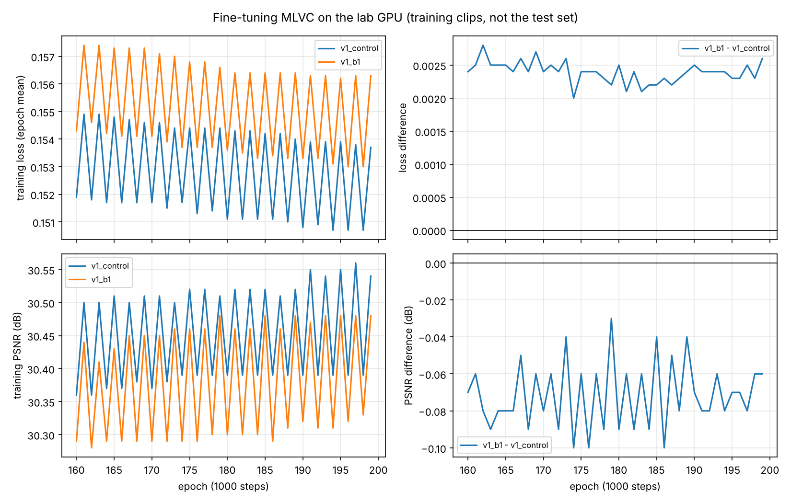

# Results

Built from the logs in [`../raw_data/logs/`](../raw_data/logs/) by [`../scripts/analyze_training.py`](../scripts/) (`python3 analyze_training.py`). So far they cover the lab setup and the first control and B1 runs (`v1_control`, `v1_b1`, 200 epochs each, 20–21 Nov 2026). Tables for the later runs are added as they finish.

**Read every number here as a training number.** It is measured on training samples, not on the VCD test clips, and it says nothing yet about drift across processors. Those are measured on the Mac.

## Files

| File | What it holds | Columns |
|---|---|---|
| [`training_cost.csv`](training_cost.csv) | The cost of training on the lab GPU | `quantity`, `value`, `note` |
| [`training_per_epoch.csv`](training_per_epoch.csv) | Every complete epoch of every run in the logs | `run`, `epoch` (from 0), `loss`, `bpp` (latent + hyperprior), `psnr_db`, `s_per_100_steps` — each the mean of the epoch's 10 log lines |
| [`training_summary.csv`](training_summary.csv) | Each run against the control trained the same way, over the epochs both have | `run`, `compared_with`, `epochs`, `n_epochs`, `loss`, `bpp`, `psnr_db`, `loss_minus_control`, `loss_diff_sd_across_epochs`, `psnr_minus_control_db`, `bpp_vs_control_pct` |
| [`training_parity.csv`](training_parity.csv) | Even and odd epochs separately, and the first vs last five of each | `run`, `parity`, `epochs`, `mean_loss`, `mean_psnr_db`, `first5_loss`, `last5_loss`, `first5_psnr_db`, `last5_psnr_db` |
| [`training_curves.png`](training_curves.png) | Loss and PSNR per epoch (left) and B1 minus control (right) | — |

The logs pushed during the runs hold the last 5,000 lines, so the tables cover epochs 160–199 (the 161st to 200th). The complete logs are in the release (`logs_full.zip`) and give the full curves with the same script.

## Analysis

### 1. Training cost

| Quantity | Value |
|---|---|
| Time per training step (2 samples × 4 frames, 256 × 256) | **0.216 s** |
| Time per epoch (1,000 steps), computing only | 3.60 min |
| Time per epoch including the restart every 2 epochs | **3.93 min** (restarts add 9 %) |
| One 200-epoch run (200,000 steps) | **13.1 h** |
| Both first runs (2 × 200 epochs) | 26.3 h (20 Nov 21:21 – 21 Nov 23:40), as predicted |
| Data preparation, once: download and unzip 50 GB | ≤ 25 min over 32 connections |
| Data preparation, once: extract 5,411 × 64 frames | 7.9 h (≈ 735 frames a minute, limited by the CPU) |

**What it means.** A complete fine-tune of MLVC fits in one night on a consumer GPU with 8 GB, so changing MLVC's network is cheap: about 13 GPU-hours per variant, after a one-time data preparation. The restart every 2 epochs costs 9 % and buys equal progress for all runs and at most one lost epoch after a crash. A dedicated GPU with more memory would train with larger batches and longer sequences, closer to MLVC's own setup; these numbers are an upper bound for what the change costs.

The first test of the training loop (20 Nov, 20 steps on 48 already extracted sequences, while extraction still used the CPU) took 14 s per step: start-up and a busy CPU. That number is not a training cost; the 0.216 s above is the steady state over 200 epochs.

### 2. The first runs replayed the same samples

The left panels of the figure zig-zag: even and odd epochs alternate between two levels, in both runs and in all 40 epochs.

| Run | Even epochs: loss / PSNR | Odd epochs: loss / PSNR | Odd − even |
|---|---|---|---|
| `v1_control` | 0.1513 / 30.38 dB | 0.1543 / 30.52 dB | +0.0030 / +0.14 dB |
| `v1_b1` | 0.1537 / 30.30 dB | 0.1567 / 30.46 dB | +0.0030 / +0.16 dB |

Random batches cannot produce a gap that is the same in every pair of epochs. The cause is in the pipeline: every 2-epoch chunk is a new process started with the same random seed, and MLVC does not save its random state in checkpoints. Each chunk therefore drew **the same 2 × 2,000 samples** (the same sequences, frames, crops and flips): the first epoch of every chunk is one fixed set, the second another. Over 200 epochs each run saw about **4,000 different samples, about 100 times each**, instead of fresh samples from the 5,411 sequences.

**Consequences.**
- **The comparison between the two runs is still fair.** Both saw identical samples in identical order, so their difference comes from the change alone.
- **Both models have probably over-fitted those 4,000 samples.** Their quality on the test clips may be lower than a proper fine-tune's, and is checked on the Mac before they are used.
- **The fix:** a different, reproducible seed for every chunk. Control and B1 are trained again with it, and every later run uses it. The first runs are kept as `v1_control` and `v1_b1`.

### 3. Still improving, but on the same samples

Comparing the first and last five epochs of the same parity (so that the same samples are compared):

| Run | Parity | Loss: epochs 160s → 190s | PSNR |
|---|---|---|---|
| `v1_control` | even | 0.1518 → 0.1508 | 30.37 → 30.39 dB |
| `v1_control` | odd | 0.1548 → 0.1538 | 30.50 → 30.55 dB |
| `v1_b1` | even | 0.1543 → 0.1531 | 30.29 → 30.32 dB |
| `v1_b1` | odd | 0.1573 → 0.1563 | 30.44 → 30.48 dB |

Both runs still lower their loss by about 0.7 % over the last 40 epochs, but on samples they have seen about 100 times; this is fitting those samples more closely, not evidence of better compression in general. With fresh samples per chunk, the retrained runs will show whether training has converged.

### 4. What B1 costs in quality

| | `v1_control` | `v1_b1` | B1 − control |
|---|---|---|---|
| Loss | 0.1528 | 0.1552 | **+0.0024 (+1.6 %)** |
| Bitrate (bpp) | 0.1127 | 0.1135 | **+0.64 %** |
| PSNR | 30.45 dB | 30.38 dB | **−0.071 dB** |

Means over epochs 160–199.

- **The cost is real and consistent.** The loss difference lies between 0.0020 and 0.0028 in every one of the 40 epochs (standard deviation 0.0002); B1 has a higher bitrate in every epoch (+0.18 % to +0.89 %) and a lower PSNR in every epoch (−0.03 to −0.10 dB). It is the same on even and odd epochs (+0.0024 both), so it does not depend on which samples are seen.
- **It is not shrinking.** The loss difference is +0.0025 over the first 10 of these epochs and +0.0024 over the last 10. Run 6 (B1 to 400 epochs, with fresh samples) tests whether more training closes it.
- **It is small.** Slightly more bits and slightly less quality at the same time; roughly a 1–2 % rate penalty, to be weighed against the drift B1 is meant to remove (in the baseline, GPU/CPU decoding drifted down to 38.5 dB on its worst frame).
- **Whether it is larger than training noise is not known yet.** The difference between epochs is tiny, but two runs of the same setup also differ; `control_s2` measures that.

**What this does and does not show.** It is the **price** of B1 on training samples. The **benefit** B1 was designed for, less drift when the decoder runs on the GPU or CPU, cannot appear in training numbers and is measured on the Mac. B1 is worth keeping if it reduces drift by clearly more than the control-to-control difference at a cost like this one.

## Next

| Run | Expected | What it adds here |
|---|---|---|
| Queue A: `control`, `b1` with a seed per chunk | About 26 h after the next start | The same comparison without replayed samples; first models for the Mac tests |
| Queue B+C: `b1gate`, `b2p25`, `b2p75`, `control_s2` | About 53 h later | Input gate and I-frame dropout against control; training noise between two controls |
| Run 6: `b1` to 400 epochs | About 13 h later | Whether B1's cost shrinks with more training |
