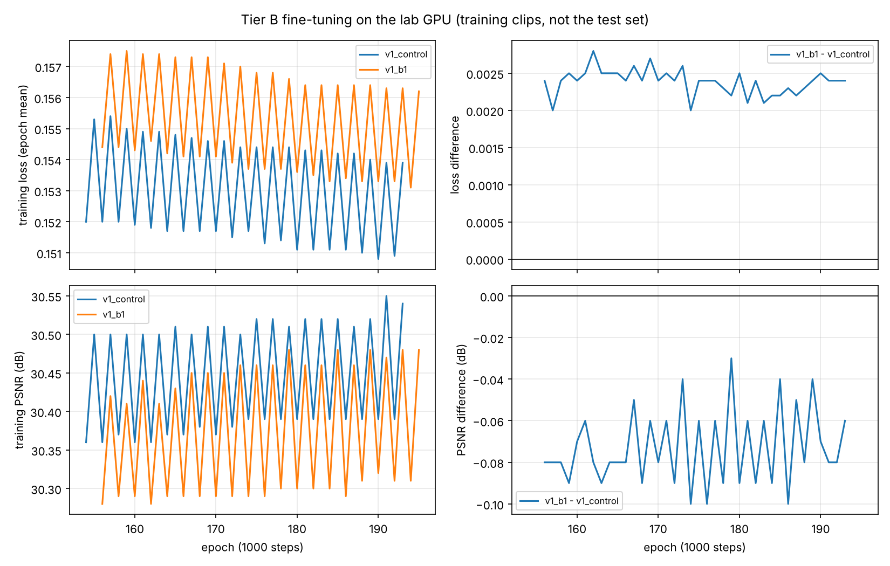

# Tier B: changing the MLVC network (fine-tuning on a lab GPU)

Tier B is DuplexNVC's **network-level** contribution (C6). The baseline showed that MLVC drifts when its decoder runs on the GPU or CPU instead of the Neural Engine (worst frame 38.5 dB, experiment 04), and that a GPU encoder costs about 4 % in bitrate (experiment 10). The codec-level mechanisms A1–A4 work around this without retraining. Tier B asks whether **small changes to the network itself**, which the MLVC paper never tested, can fix the cause.

A changed network has to be retrained, which needs a CUDA GPU. Training therefore runs on a lab PC; **every trained model is then converted and tested on the M4 Pro Mac** with the same tools as the baseline (quality, drift across NE/GPU/CPU, speed, energy). The lab produces models and training logs only, never final results.

## The runs

Every run fine-tunes MLVC from its released PSNR checkpoint (`mlvc-psnr-v1.ckpt`) on the same data with the same settings, changing **one** thing:

| Run | Name | Change | Hypothesis / why |
|---|---|---|---|
| 1 | `control` | nothing | Reference: fine-tuning alone changes a model a little, so every change is compared with a control trained the same way |
| 2 | `b1` | memory gates piecewise-linear: `memory_activation: hard_tanh`, `gate_activation: hard_sigmoid` (options already in MLVC's code) | Smooth functions (tanh, sigmoid) are computed slightly differently on the NE, GPU and CPU, and the decoder's memory carries those differences from frame to frame. Straight-line pieces are computed the same way everywhere, so **drift should shrink** |
| 3 | `b1gate` | B1 **plus a separate input gate** (`model.p_frame.input_gate: true`, added by `scripts/patch_input_gate.py`) | MLVC's memory uses one knob, `m = f·m + (1 − f)·s`. With an input gate, `m = f·m + i·s`, as in a standard LSTM, the network can keep the old state and limit what it adds independently, which may control drift better than B1 alone |
| 4 | `b2p25` | I-frame dropout 0.25 (MLVC uses 0.5) | How often training starts a sequence without an I-frame decides how the P-frame model copes without a key frame: affects recovery after loss (E3, E4) and long-term references |
| 5 | `b2p75` | I-frame dropout 0.75 | The other side of the same trade-off |
| 7 | `control_s2` | control with other random seeds | **Training noise**: an effect counts only if it is larger than the difference between two identical controls |
| 6 | `b1` (continued) | B1 trained 2× longer (epochs 200–399) | Does B1's small quality cost shrink with more training? |

The input gate starts as `i = 1 − f` (its weights are the negated forget-gate weights, and `hard_sigmoid(−x) = 1 − hard_sigmoid(x)`), so `b1gate` starts **exactly** equal to B1 and training then learns to separate the two gates. This was checked: outputs of the two models match to 10⁻⁷ before training, the gate receives gradients, and checkpoints reload.

## Setup

| | |
|---|---|
| GPU | NVIDIA GeForce RTX 3060 Ti, 8 GB, driver 560.94 (CUDA 12.6) |
| OS / shell | Windows, PowerShell 5.1 (lab PC, no admin rights) |
| Code | [microsoft/mlvc](https://github.com/microsoft/mlvc) `main`, downloaded 19 Nov 2026 (the repository's `main` was then commit `f597bf7`) |
| Python / PyTorch | Python 3.12.16 and PyTorch 2.10.0+cu128, installed by `uv` 0.13.9 from MLVC's `pyproject.toml` |
| ffmpeg | Portable build N-129130 (BtbN, 19 Nov 2026), installed by the script |
| Starting weights | P-frame `mlvc-psnr-v1.ckpt`; I-frame model DMCI-6.0 (`cvpr2025_image.pth.tar` from the DCVC release) |
| Training data | OpenVidHD part 10 (10,710 videos) and MLVC's own list of 64-frame sequences (`openvidhd_60k64_frame_sequences.csv`); **5,411 sequences** of that list are in part 10, all extracted |

### Fine-tuning settings (all runs)

| Setting | Value | Why |
|---|---|---|
| Patches | 256 × 256, sequences of **4 frames**, batch **2** | Fits 8 GB of GPU memory (MLVC itself trained on 32 GB GPUs) |
| Resolution | content rescaled to 360p | Our core setting |
| Learning rate | 1·10⁻⁵, constant | Fine-tuning from a converged model; close to the late stage of MLVC's own schedule |
| Loss | MLVC's `total_rdc_psnr`, cascaded, distortion weights [0.52, 1.33, 0.83], bpp weight 1 | MLVC's own late-stage settings |
| I-frame dropout | 0.5 (B2: 0.25 / 0.75) | MLVC's value |
| Epoch | 2,000 samples = 1,000 steps; **200 epochs** per run (≈ 200,000 steps) | A checkpoint every epoch |
| Memory saving | backprop checkpoints on; `torch.compile` off, `flat_parameters` off | Compiling is unreliable on Windows; MLVC's flat parameters require it |
| Validation during training | off | The VCD test clips downloaded too slowly on the lab network; every model is tested on the Mac instead |
| Scheduling | the runs of a queue take turns, 2 epochs each; each 2-epoch chunk is a separate process that resumes from the last checkpoint | All runs of a queue are always equally far, and a crash or restart loses at most one epoch |
| Random seed | **per chunk**: `seed = base × 100000 + last epoch of the chunk` | MLVC does not save its random state in checkpoints, so a fixed seed makes every chunk replay the same samples (see v1 below). Runs of a queue share the seed schedule, so they see the same samples in the same order (a paired comparison); `control_s2` uses another base |

## What `scripts/lab.ps1` does

One PowerShell script runs everything on the lab PC (`powershell -ExecutionPolicy Bypass -File .\lab.ps1 <command>`):

| Command | What it does | When |
|---|---|---|
| `setup` | Installs `uv`, downloads MLVC (zip if `git` is missing), installs its environment, checks the GPU, downloads the P-frame checkpoint and MLVC's sequence list | Once |
| `ffmpeg` | Installs a portable ffmpeg (no admin) and prints its version | Once (also done automatically) |
| `github <owner>/<repo> "Name" email` | Stores a GitHub token for progress pushes | Once |
| `weekend` | Starts the whole pipeline in a separate minimized window: download OpenVidHD part 10 (32 parallel connections), unzip, extract MLVC's sequences, keep only fully extracted ones, then train every queue and push progress to GitHub after each round | Each visit |
| `status` | GPU use, free disk, last lines of every log | Any time |
| `upload` | Puts chosen checkpoints (epochs 10, 25, 50, 100, 150, 200, 300, 400 of every run; model weights only, ≈ 73 MB each) and the full logs on a GitHub release | After a queue finishes |
| `push`, `fixdata` | Push the logs now; rebuild the list of usable sequences | When needed |

On every start the script also applies two small source changes to its copy of MLVC: the input gate (`patch_input_gate.py`, inactive unless a run enables it) and `-vsync 0` → `-fps_mode passthrough` in MLVC's ffmpeg call (current ffmpeg builds removed `-vsync`).

`scripts/analyze_training.py` turns the logs into the tables and figure in `results/`.

### Problems met while setting up, and their fixes

| Problem | Cause | Fix in `lab.ps1` |
|---|---|---|
| Downloads at 100–300 kB/s (VCD clips: 43 h estimated) | One slow connection to the storage server | Large files downloaded over 32 ranged connections; VCD not downloaded at the lab |
| Every training start failed at once | MLVC's `flat_parameters` requires `torch.compile`, which we turn off | `train.flat_parameters: false` |
| Training failed on a missing frame | Sequence extraction had failed silently, but the dataset list is built from the CSV, not from the files | Only fully extracted sequences are kept (`fixdata`); a run stops if none are |
| Extraction failed (`WinError 2`) | ffmpeg not installed on the lab PC | Portable ffmpeg downloaded automatically |
| Extraction failed (ffmpeg exit code −1414549496, "option not found") | Current ffmpeg removed `-vsync` | MLVC's call patched to `-fps_mode passthrough` |
| v1 runs saw only ≈ 4,000 distinct samples | Fixed seed + restart every 2 epochs + MLVC not saving the random state | Seed per chunk; control and B1 retrained |

## Results so far

### E5: the cost of training (measured)

| Quantity | Value |
|---|---|
| Time per training step (batch 2 × 4 frames, 256²) | **0.22 s** |
| Time per epoch (1,000 steps), including the restart every 2 epochs | **3.9 min** |
| One fine-tune of 200 epochs (200,000 steps) | **≈ 13 h** on one RTX 3060 Ti (8 GB) |
| Data preparation (download 50 GB, extract 5,411 sequences) | ≈ 8 h, once |

Network-level changes to MLVC are therefore cheap to make: a full fine-tune fits in one night on a consumer GPU. From [`results/training_cost.csv`](results/training_cost.csv).

### First control and B1 runs (v1) — training metrics only

The first runs of control and B1 (200 epochs each, 20–21 Nov) used a fixed seed, so **every 2-epoch chunk replayed the same ≈ 4,000 samples** (the zig-zag between even and odd epochs in the figure). Both runs saw identical samples, so the comparison between them is fair, but both have probably over-fitted those samples. They are kept as `v1_control` and `v1_b1` and retrained with a seed per chunk.

| Run | Loss | bpp | PSNR (dB) | vs. v1 control |
|---|---|---|---|---|
| `v1_control` | 0.1530 | 0.1128 | 30.45 | — |
| `v1_b1` | 0.1554 | 0.1136 | 30.37 | loss +0.0024 (+1.6 %), bpp +0.7 %, **PSNR −0.07 dB** |

Means over epochs 156–193 (the epochs in the pushed logs), training clips. The difference is the same in every epoch (standard deviation of the loss difference 0.0002), so it is not noise between epochs; whether it is larger than the noise **between runs** needs `control_s2`.



**What this does and does not show.** It is the **price** of B1 on training data: about 0.07 dB. The **benefit** B1 was designed for, less drift on the GPU and CPU, cannot appear in training numbers; it is measured on the Mac. These are training-set numbers on over-fitted v1 models, not test results.

## Status and next steps

| Step | Status |
|---|---|
| B0: environment, data, training cost (E5) | Done (20 Nov) |
| v1 control and B1 | Done (21 Nov); kept for reference |
| Queue A: control and B1, seed per chunk | Next |
| Queue B+C: B1 + input gate, B2 (0.25, 0.75), control seed 2 | After Queue A |
| Run 6: B1 to 400 epochs | Last |
| Tests on the Mac: quality on VCD, drift across NE/GPU/CPU, speed, energy; pick the Tier B winner for the controller | After each queue |

Before the Mac tests, the success criterion is fixed: a change helps only if it reduces drift by more than the difference between `control` and `control_s2`, at a quality cost on VCD below about 0.2 dB. Earlier checkpoints (epochs 50–150) are tested too, in case later ones over-fit.

## Files

```
tier_b/
├── README.md                 this file
├── REPRODUCE.md              how to rerun the training and rebuild the results
├── scripts/
│   ├── lab.ps1               the whole lab pipeline (Windows PowerShell)
│   ├── patch_input_gate.py   adds the optional input gate to MLVC's decoder memory
│   └── analyze_training.py   logs -> results/ (tables, figure, training cost)
├── raw_data/logs/            logs pushed from the lab PC (last 5,000 lines of each training log)
│   ├── pipeline.txt          every start, data step, round and failure, with times
│   ├── prep.txt              data download and extraction
│   ├── v1_control.txt        v1 control training log
│   └── v1_b1.txt             v1 B1 training log
└── results/
    ├── training_per_epoch.csv   loss, bpp, PSNR, time per 100 steps, per run and epoch
    ├── training_summary.csv     per run: means and difference to its control
    ├── training_cost.csv        E5
    └── training_curves.png      the figure above
```

Model checkpoints (≈ 73 MB each, 200 per run) are too large for this repository. `lab.ps1 upload` publishes selected epochs and the complete logs (from epoch 0) as a GitHub release.
